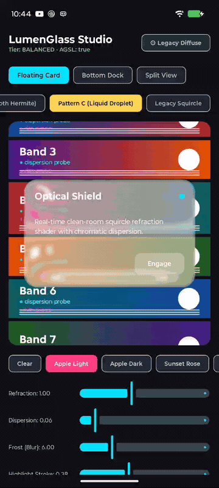
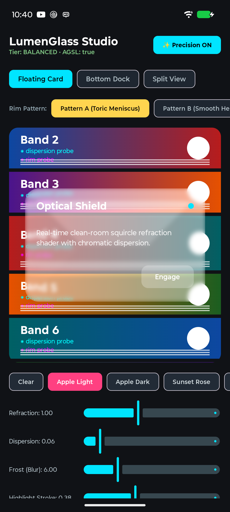
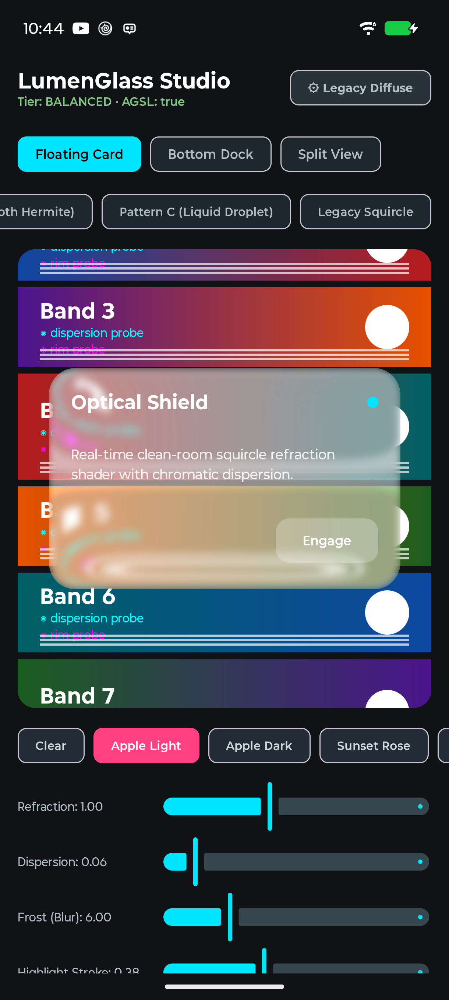
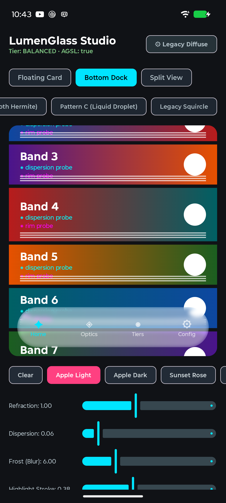
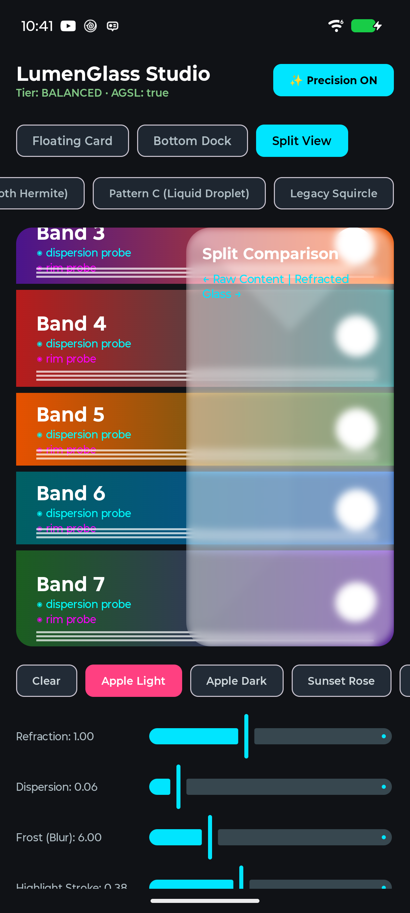

<p align="center">
  <h1 align="center">✨ Lumen Glass ✨</h1>
  <p align="center">
    <strong>Physically Accurate, Clean-Room Liquid Glass for Android & Jetpack Compose</strong>
  </p>
  <p align="center">
    <a href="https://jitpack.io/#SubhankarCodeGeek/lumen-glass"></a>
    
    
    
    <a href="LICENSE"></a>
    
  </p>
</p>

<p align="center">
  <em>Lumen Glass brings Apple's iconic <strong>Liquid Glass</strong> material to Android. Powered by custom AGSL runtime shaders, real-time toric meniscus magnification, full-perimeter dual-lobe specular highlights, chromatic dispersion, and an adaptive 60 FPS pipeline — on a substrate <strong>we own end-to-end</strong>.</em>
</p>

<p align="center">
  
</p>

---

## 📸 Showcase & Visual Bending Modes

<table>
  <tr>
    <td align="center" width="25%">
      <strong>Pattern A: Toric Meniscus</strong><br />
      <sub>Spherical rim zoom & physical magnification</sub><br />
      
    </td>
    <td align="center" width="25%">
      <strong>Legacy Diffuse & Bending</strong><br />
      <sub>Intense pixel warping & chromatic dispersion</sub><br />
      
    </td>
    <td align="center" width="25%">
      <strong>Liquid Glass Bottom Dock</strong><br />
      <sub>Pill navigation with continuous rim refraction</sub><br />
      
    </td>
    <td align="center" width="25%">
      <strong>Split Comparison View</strong><br />
      <sub>Raw background content vs. Refracted glass</sub><br />
      
    </td>
  </tr>
</table>

---

## 🌟 Why Lumen Glass?

Existing Android glass implementations are **shallow wrappers** over third-party backdrop libraries, featuring flat edge-steps and blacked-out rims. Lumen Glass was re-engineered from optical physics and analytical geometry to solve these limitations:

```
┌─────────────────────────────────────────────────────────────────────────────┐
│                           LUMEN GLASS OPTICS                                │
│                                                                             │
│   Incoming Light                                                            │
│        ↓↓↓↓↓↓                                                               │
│   ┌───────────────┐  ◄─── 360° Highlight Stroke + Top Specular Sheen       │
│  /  Toric Refract  \ ◄─── Physical Zoom Meniscus: d(u) = 1 - √(1 - u²)      │
│ │   Chrom. Disperse │ ◄─── Wavelength Aberration: λ_R > λ_G > λ_B           │
│ │   Separable Blur  │ ◄─── Hardware Platform Blur (Separable H+V)           │
│  \─────────────────/                                                        │
└─────────────────────────────────────────────────────────────────────────────┘
```

### Head-to-Head Comparison

| Feature | Lumen Glass | `kyant0:backdrop` | `FletchMcKee/liquid` |
|---|---|---|---|
| **Edge Magnification** | **Spherical Toric Meniscus** ($1.0 - \sqrt{1 - u^2}$) with physical zoom | Flat early-return in centre | Saturates to 0; no boundary zoom |
| **Edge Profiles** | **3 Profiles**: Toric Meniscus, Smooth Hermite, Liquid Droplet | 1 fixed falloff | 1 fixed falloff |
| **Highlight Contour** | **360° Perimeter Stroke** (28% ambient floor) + directional sheen | Directional only (bottom blacks out) | Single uniform border |
| **Lens Distribution** | **Continuous Blend**: Centre-lens + Rim-lens + Blend | Rim-only (middle remains flat) | Rim-only |
| **Aspect Ratio Handling** | **Aspect-Agnostic Superellipse**: Correct on banners & cards | Squircle collapses on non-square | Squircle collapses on non-square |
| **Substrate Ownership** | **100% Owned** (`RenderNode` capture + `RenderEffect`) | External `LayerBackdrop` dependency | External `LiquidState` dependency |
| **Licensing** | **100% Clean-Room Apache-2.0** (independently derived) | Apache-2.0 | Apache-2.0 |
| **Fallback Strategy** | **Graceful Frost Panel** on API < 33 (Zero crashes) | Fails / crashes on unsupported APIs | Fails on unsupported APIs |

---

## 🔬 Optical Physics & Rim Profiles

Lumen Glass includes three distinct mathematical edge-bending profiles:

### 1. Pattern A: Toric Meniscus (`RimProfile.TORIC`) — *Default*
* **The Physics**: Recreates the circular cross-section of a rounded glass lens:
  $$\text{depth}(u) = 1.0 - \sqrt{\max(0.0, 1.0 - u^2)}$$
* **The Look**: Displaces background pixels inward along boundary normals. Background elements passing under the edge undergo **magnified optical distortion**, matching genuine physical glass and iOS Control Center panels.

### 2. Pattern B: Smooth Hermite (`RimProfile.SMOOTH`)
* **The Physics**: A $G^2$-continuous curvature fillet combining linear progression with quadratic acceleration:
  $$\text{curve}(u) = 0.30u + 0.70u^2$$
* **The Look**: Velvety, seamless transition without sudden slope jumps. Ideal for subtle, ultra-modern interfaces and status overlays.

### 3. Pattern C: Liquid Droplet (`RimProfile.DROPLET`)
* **The Physics**: A bipolar fluid meniscus combining an outward environmental refraction bulge with perimeter inward magnification:
  $$\text{bulge}(u) = \sin(\pi u), \quad \text{zoom}(u) = 1.0 - \sqrt{1.0 - u^2}$$
* **The Look**: Creates organic fluid-droplet refraction where content appears to swell outward slightly before tucking beneath the rim.

---

## 💡 Dual-Lobe Lighting & Perimeter Sheen

Traditional shaders compute specular highlights using a single directional dot product $\max(0, \vec{N} \cdot \vec{L})^p$. While this illuminates the top edge, it causes bottom and side edges to black out completely.

Lumen Glass solves this with a **dual-lobe perimeter model**:
1. **Directional Specular Sheen**: High-power specular lobe focused along the top-left incident light vector ($\vec{L} = [-0.60, -0.80]$).
2. **360° Ambient Contour**: A calibrated 28% ambient baseline floor ensuring a crisp, structural 1.5–2.0px hairline stroke remains visibly defined around all four sides.

---

## 📦 Installation

### 1. Add JitPack Repository
Add JitPack to your root `settings.gradle.kts`:

```kotlin
dependencyResolutionManagement {
    repositories {
        google()
        mavenCentral()
        maven { url = uri("https://jitpack.io") }
    }
}
```

### 2. Add Dependency
Add Lumen Glass to your app module's `build.gradle.kts`:

```kotlin
dependencies {
    implementation("com.github.SubhankarCodeGeek:lumen-glass:0.1.1")
}
```

---

## 🚀 Quick Start

### Basic Floating Glass Card

```kotlin
import androidx.compose.foundation.layout.*
import androidx.compose.material3.Text
import androidx.compose.runtime.Composable
import androidx.compose.ui.Alignment
import androidx.compose.ui.Modifier
import androidx.compose.ui.graphics.Color
import androidx.compose.ui.unit.dp
import com.subhankar.lumenglass.compose.LumenSource
import com.subhankar.lumenglass.compose.lumenGlass
import com.subhankar.lumenglass.compose.rememberLumenGlassState
import com.subhankar.lumenglass.core.LensModel
import com.subhankar.lumenglass.core.RimProfile

@Composable
fun GlassCardExample() {
    val glassState = rememberLumenGlassState()

    Box(Modifier.fillMaxSize()) {
        // 1. Mark your background to be captured into the glass substrate
        LumenSource(
            state = glassState,
            modifier = Modifier.fillMaxSize()
        ) {
            // Your scrolling feed, wallpapers, or dashboard content
            WallpaperOrContent()
        }

        // 2. Apply the .lumenGlass modifier to your glass element
        Box(
            modifier = Modifier
                .align(Alignment.Center)
                .size(width = 340.dp, height = 200.dp)
                .lumenGlass(
                    state = glassState,
                    cornerRadius = 28.dp // Automatically matches rim width to corner radius
                ) {
                    refraction = 1.0f
                    dispersion = 0.08f
                    frost = 6.dp
                    highlightStroke = 0.28f
                    rimProfile = RimProfile.TORIC
                    tint = Color.White.copy(alpha = 0.12f)
                    lens = LensModel.Blend(centre = 0.2f, rim = 0.8f)
                }
        ) {
            Text(
                text = "Liquid Glass",
                color = Color.White,
                modifier = Modifier.align(Alignment.Center)
            )
        }
    }
}
```

---

## 🛠️ Recipes

<details>
<summary><strong>Liquid Glass Bottom Navigation Dock</strong></summary>

```kotlin
Box(
    modifier = Modifier
        .align(Alignment.BottomCenter)
        .padding(bottom = 32.dp)
        .fillMaxWidth(0.92f)
        .height(72.dp)
        .lumenGlass(
            state = glassState,
            cornerRadius = 36.dp
        ) {
            refraction = 1.15f
            dispersion = 0.10f
            frost = 8.dp
            highlightStroke = 0.32f
            rimProfile = RimProfile.TORIC
            tint = Color(0xFF1E222A).copy(alpha = 0.25f)
        }
) {
    // Dock Icons
}
```
</details>

<details>
<summary><strong>Velvety Control Center Sheet (Pattern B)</strong></summary>

```kotlin
Box(
    modifier = Modifier
        .fillMaxWidth()
        .height(280.dp)
        .lumenGlass(
            state = glassState,
            cornerRadius = 32.dp
        ) {
            refraction = 0.85f
            dispersion = 0.04f
            frost = 10.dp
            highlightStroke = 0.22f
            rimProfile = RimProfile.SMOOTH // Soft continuous Hermite curvature
            tint = Color.Black.copy(alpha = 0.35f)
        }
)
```
</details>

---

## 🎛️ Optical Knobs Reference

All visual parameters in `GlassSpec` are typed, validated, and hot-reloadable:

| Parameter | Type | Default | Description |
|---|---|---|---|
| `refraction` | `Float` | `1.0f` | Refractive bending strength ($0.0$ to $2.0$). |
| `dispersion` | `Float` | `0.06f` | Chromatic dispersion aberration (RGB wavelength splitting). |
| `frost` | `Dp` | `6.dp` | Hardware-accelerated separable Gaussian blur radius ($0$ to $24\text{dp}$). |
| `highlightStroke` | `Float` | `0.28f` | Baseline luminance for the 360° perimeter highlight stroke. |
| `edgeLight` | `Float` | `0.10f` | Directional specular sheen intensity on the top-left incident rim. |
| `rimProfile` | `RimProfile` | `TORIC` | Refraction geometry: `TORIC`, `SMOOTH`, `DROPLET`, or `LEGACY`. |
| `lens` | `LensModel` | `Blend(0.4f, 0.6f)` | Lens distribution: `Centre(w)`, `Rim(w)`, or continuous `Blend(c, r)`. |
| `tint` | `Color` | `Transparent` | Translucent glass surface tint. |
| `saturation` | `Float` | `1.0f` | Rec. 709 luma-preserving saturation adjustment ($0.0$ to $2.0$). |
| `contrast` | `Float` | `1.0f` | S-curve contrast grading ($0.5$ to $1.5$). |
| `bezel` | `Bezel?` | `Bezel.soft(12.dp)` | Optional inner shadow boundary contour. |

---

## ⚡ Adaptive Performance Architecture

Lumen Glass was designed from day one to uphold a strict **60 FPS frame-time budget** on mobile hardware:

| Quality Tier | Pipeline Execution | Target Hardware |
|---|---|---|
| **`HIGH`** | Full-resolution multi-sample AGSL + Chromatic Dispersion + Hardware Blur + Bezel | Modern Flagship GPUs |
| **`BALANCED`** | Separable Platform Blur + Calibrated Refraction + Perimeter Highlight | Mainstream / Mid-range |
| **`LOW`** | Reduced-resolution capture (`0.5x` fragment work) + Single-tap lens + Tint | Entry-level / Android Go |
| **`FALLBACK`** | Graceful frosted surface via standard Android graphics (API < 33) | Legacy / Non-AGSL |

* **Hardware-Accelerated Blur**: Utilizes the platform's native two-pass separable Gaussian blur (`RenderEffect.createBlurEffect`), bypassing naive in-shader 81-tap loops.
* **Aspect-Agnostic Superellipse**: Coordinates are normalized to $[-1, 1]$ on each axis, ensuring squircle boundaries never deform or zero out on wide banners.
* **Zero Allocation on Render**: Uniform arrays and shader objects are reused; zero garbage collection pauses during animations.

---

## 🏛️ Architecture & Clean-Room Guarantee

```
LumenGlass/
├── library/
│   ├── core/         # Pure platform-agnostic optical model (zero Android/androidx imports)
│   ├── android/      # RuntimeShader, RenderEffect, RenderNode capture substrate
│   └── compose/      # Public Jetpack Compose APIs (Modifier.lumenGlass, LumenSource)
├── app/              # Interactive LumenGlass Studio testbed with real-time controls
└── benchmark/        # Macrobenchmark frame-timing verification harness
```

> **Clean-Room Attestation:** Every mathematical equation, signed distance function, and AGSL shader block in this library was derived independently from analytical geometry, Snell's law of refraction, and Inigo Quilez's public 2D distance functions. No proprietary or unlicensed third-party shader code was used. See [`CLEANROOM.md`](CLEANROOM.md) for the mathematical provenance record.

---

## 🤝 Contributing

Contributions, feature requests, and bug reports are welcome!
Feel free to open an issue or submit a pull request.

1. Fork the Project
2. Create your Feature Branch (`git checkout -b feature/AmazingOptics`)
3. Commit your Changes (`git commit -m 'Add AmazingOptics'`)
4. Push to the Branch (`git push origin feature/AmazingOptics`)
5. Open a Pull Request

---

## Copyright and License

Copyright © 2026 Subhankar Bag.

Lumen Glass is open-source software licensed under the Apache License, Version 2.0.

You are free to use, modify, and distribute the software in accordance with the licence terms.

See the [LICENSE](LICENSE) file for details.

In individual source files: you can use a concise copyright and SPDX header where appropriate:

```kotlin
/*
 * Copyright 2026 Subhankar Bag.
 * SPDX-License-Identifier: Apache-2.0
 */
```
